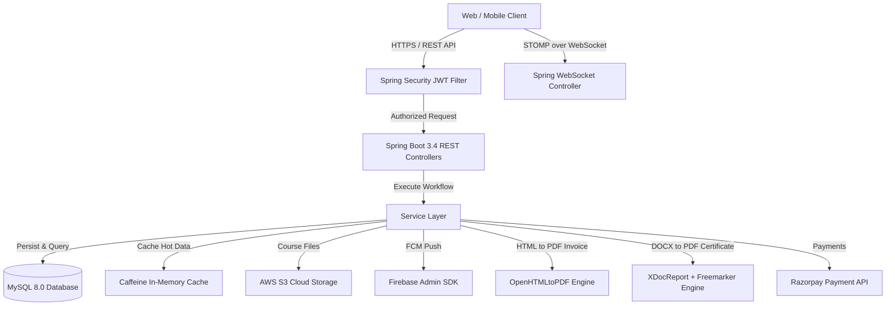

# Tutorio LMS Backend

## Overview

Tutorio LMS Backend is a multi-role educational platform designed to streamline course creation, live interactive learning, automated student assessment, billing workflows, and digital credential distribution. The platform solves core operational challenges faced by educational institutions, including automated certificate issuance upon course completion, zero-dependency PDF invoice rendering, real-time live classroom interactions, and multi-channel push notification dispatch.

---

## Key Features

- **Course & Content Delivery:** Structured course management supporting modules, video lessons, dynamic downloadable assets, and ebook distribution.
- **Automated PDF Certificate Generation:** Dynamic DOCX template population using **XDocReport** and **Freemarker**, automatically generating verifiable PDF completion certificates.
- **Pure Java Invoice Rendering Engine:** Fast, zero-overhead HTML-to-PDF invoice rendering via **OpenHTMLtoPDF** without external Node/Puppeteer dependencies.
- **Multi-Channel Push Notifications:** Asynchronous mobile and web push notifications powered by **Firebase Admin SDK 9.2.0**.
- **Interactive Live Sessions:** Real-time chat, live Q&A, and interactive test countdowns powered by **Spring WebSockets (STOMP Protocol)**.
- **Monetization & Billing Integration:** Payment checkout, order management, and subscription verification using **Razorpay Java SDK**.
- **Multi-Cloud Asset Pipeline:** Asset storage on **AWS S3 (v2 SDK)** with automated backup synchronization via **Google Drive API v3**.

---

## Architecture

The backend follows a clean, layered MVC architectural pattern designed for modularity, maintainability, and clear separation of concerns:

- **Web / Controller Layer (`com.affycloud.TutorioBackend.controllers`):** Exposes RESTful endpoints, handles HTTP request validation, and returns structured API responses.
- **Service Layer (`com.affycloud.TutorioBackend.services`):** Encapsulates core business workflows, transaction boundaries, document rendering pipelines, and third-party integrations.
- **Data Access Layer (`com.affycloud.TutorioBackend.repositories`):** Spring Data JPA repositories interfacing with MySQL for optimized entity persistence and dynamic queries.
- **Security & Infrastructure Layer (`com.affycloud.TutorioBackend.config` & `utils`):** Implements JWT filter chains, BCrypt hashing, Spring Security RBAC, global exception handling, and Caffeine caching.

---

## Tech Stack

| Category | Technology |
| :--- | :--- |
| **Language** | Java 21 LTS |
| **Framework** | Spring Boot 3.4.9, Spring MVC, Spring Data JPA |
| **Database** | MySQL 8.0, H2 (Development & Testing) |
| **Messaging & Notifications** | Spring WebSockets (STOMP), Firebase Admin SDK (FCM) |
| **Cache** | Caffeine In-Memory Cache (`com.github.ben-manes.caffeine`) |
| **Security** | Spring Security, JJWT (`io.jsonwebtoken` 0.12.3), BCrypt (`at.favre.lib:bcrypt`) |
| **Cloud & Storage** | AWS S3 SDK v2 (`software.amazon.awssdk`), Cloudinary, Google Drive API v3 |
| **Document Generation** | XDocReport 2.0.3 + Freemarker, OpenHTMLtoPDF 1.0.10 |
| **Payments** | Razorpay Java SDK 1.4.3 |
| **DevOps & Build** | Docker, Docker Compose, Gradle, GitHub Actions CI/CD |
| **Testing** | JUnit 5, Spring Boot Test, Spring Security Test |

---

## System Architecture



---

## Backend Design

The application is structured into clear functional modules:

- **`CourseController` & `CourseService`:** Handles course catalogs, module hierarchies, video lesson progress tracking, and access permissions.
- **`TestService` & `ExamService`:** Manages quiz generation, time-bounded submissions, automated scoring, and performance analytics.
- **`CertificateService` & `InvoiceGeneratorService`:** Listens for course completion events to inject dynamic student metadata into Freemarker templates and render downloadable PDF documents.
- **`FCMService`:** Dispatches targeted and bulk push notifications for upcoming exams, course additions, and system announcements.

---

## Database Design

Key domain entities mapped via Spring Data JPA:

- **`User`:** Stores user credentials, contact information, role (`ROLE_ADMIN`, `ROLE_TEACHER`, `ROLE_STUDENT`), and account state.
- **`Course`:** Represents educational packages with relational mappings (`OneToMany`) to modules, lessons, and reviews.
- **`Order`:** Tracks course purchases, Razorpay transaction IDs, order status, and billing details.
- **`Enrollment`:** Maps student access to purchased courses with progress percentages and completion dates.
- **`Test` & `Submission`:** Stores quiz questions, student choices, calculated marks, and passing status.

---

## API Documentation

Interactive API documentation is generated using **SpringDoc OpenAPI 3.0**:

- **Swagger UI URL:** `http://localhost:8080/swagger-ui/index.html`
- **OpenAPI Schema URL:** `http://localhost:8080/v3/api-docs`

### Key Endpoints Overview

| Method | Endpoint | Description | Access |
| :--- | :--- | :--- | :--- |
| `POST` | `/api/auth/register` | Register new student or instructor account | Public |
| `POST` | `/api/auth/login` | Authenticate credentials and receive JWT token | Public |
| `GET` | `/api/courses` | Fetch public course catalog with filters & pagination | Public |
| `POST` | `/api/orders/create` | Initialize Razorpay payment order for course purchase | Authenticated |
| `POST` | `/api/certificates/generate/{courseId}` | Generate signed completion certificate PDF | Student |
| `GET` | `/api/student/dashboard` | Retrieve enrolled courses, progress, & upcoming tests | Student |
| `POST` | `/api/admin/courses` | Create or update course module hierarchy | Admin / Teacher |

---

## Security

- **Stateless JWT Authentication:** Short-lived access tokens (`jwt.accessToken.expiration`) paired with refresh tokens.
- **Password Protection:** Passwords stored using strong BCrypt hashing algorithm (`at.favre.lib:bcrypt`).
- **Role-Based Access Control (RBAC):** Fine-grained method security enforcing role boundaries using Spring Security annotations.
- **Externalized Credentials:** Sensitive production credentials (database passwords, JWT secret keys, API credentials) are loaded dynamically via environment variables (`${VAR_NAME}`).

---

## Messaging & Caching

- **STOMP WebSockets:** Real-time bidirectional communication channel supporting live Q&A sessions and instant classroom notifications.
- **Firebase FCM Engine:** Asynchronous push notification pipeline supporting single-device and topic-based broadcast messaging.
- **Caffeine In-Memory Caching:** High-performance local cache configured via Spring Cache abstraction (`@Cacheable`, `@CacheEvict`) for frequently accessed public course catalogs.

---

## Error Handling

Global exception management is handled via `@RestControllerAdvice`:

- **Consistent Error Structure:** Standardized `ApiResponse<T>` payload returning timestamp, HTTP status code, message, and error details.
- **Validation Exceptions:** Form field validation failures (`@Valid`, `@NotNull`) are intercepted and formatted into clear field-error mappings.
- **Sanitized Failure Responses:** Internal exception stack traces are logged securely on the server and hidden from public API responses to prevent information leakage.

---

## Testing Strategy

- **Frameworks:** JUnit 5 (JUnit Jupiter) and Spring Boot Starter Test.
- **Unit Testing:** Isolated unit tests verifying domain utilities (`PhoneNumberUtilTest`, `StudentProfileUpdateTest`).
- **Integration Testing:** Spring Security context testing for authentication boundaries and protected endpoints.

---

## Running Locally

### Prerequisites

- **Java Development Kit (JDK):** Version 21
- **Database:** MySQL 8.0 (or H2 in-memory mode)
- **Build Tool:** Gradle 8.x

### Build & Execution Commands

```bash
# Clone the repository
git clone https://github.com/Arbazkhan001/tutorio-lms-backend.git
cd tutorio-lms-backend

# Build the application
./gradlew build -x test

# Run the application using the development profile
./gradlew bootRun --args='--spring.profiles.active=dev'
```

---

## Environment Variables

Configure the following environment variables or place them in `src/main/resources/application-prod.properties`:

```properties
# Database Credentials
DB_HOST=localhost
DB_PORT=3306
DB_NAME=tutorio_db
DB_USER=root
DB_PASS=your_db_password

# Authentication & JWT
JWT_SECRET=your_base64_encoded_jwt_secret_key_here

# Third-Party Integrations
AWS_ACCESS_KEY=your_aws_access_key
AWS_SECRET_KEY=your_aws_secret_key
AWS_S3_BUCKET=your_s3_bucket_name
RAZORPAY_KEY_ID=your_razorpay_key_id
RAZORPAY_KEY_SECRET=your_razorpay_key_secret
```

---

## Docker

A production-ready `docker-compose.yml` is provided for containerized deployment:

```bash
# Launch application and MySQL database in detached mode
docker compose up -d

# View container logs
docker compose logs -f app

# Stop containers
docker compose down
```

---

## Future Improvements

- Implementation of Redis distributed cache cluster for multi-instance horizontal scaling.
- Asynchronous event processing via Apache Kafka for audit logging and analytics processing.
- Containerized Kubernetes deployment manifests (Helm Charts) for auto-scaling workloads.
